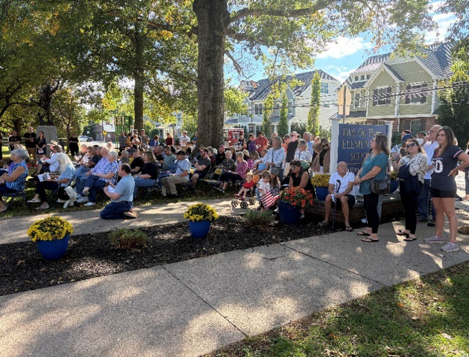

Frenchtown Elementary School (FES) held its centennial celebration on October 3. Previously scheduled for September 28, the event was postponed due to inclement weather conditions.

The event kicked off with an opening ceremony featuring the FES band and choir directed by music teacher Peggy Ippolito and an introduction from Kate Nugent, Board of Education President. The band played a series of pep tunes and the choir followed up with singing FES alma mater “Hail Frenchtown!” written by Audrey Kish-Kiley.

Michelle Liebtag, Borough Council President, Juan Torres, Hunterdon County Interim Super-intendent, Jim Hintenach, Chief School Administrator and Sandy Miller, Centennial Coordinator and Secretary of FES all made remarks.

Kathy Skerbetz, a retired preschool teacher's aide, honored her great aunt Edith Ort Thomas. Ort Thomas was a math teacher and board member who served FES for over 50 years. In 1976, the school was renamed Edith Ort Thomas Elementary School in honor of her years of dedication.

Seventh grade students Avielle McAllister and Ardiana Berisha shared the history of the Spirit of the American Doughboy statue in front of the school. The statue is a memorial to Frenchtown men who served in World War I. The Doughboy was created by E. M. Viquesney, a Spanish-American War veteran and sculptor from Indiana. The sculpture represents a World War 1 infantryman and is one of eight versions of the statue in New Jersey.

“Together our school and the Doughboy remind us that history is not only something we remember; it is something we carry forward,” said McCallister.

Memorabilia was arranged in the cafeteria and guests were invited to view the collection. Collected pieces included graduation pictures from when FES was a high school, yearbooks, letters and newspaper clippings that were either donated by alumni or part of FES’s vast collection.

Rick Epstein’s newly released book *Terriers Forever* was available for purchase. “One of our FES parents, Natasha Mikhalchuk, worked with the late Rick Epstein to write our book,” said Sandy Miller.

The centennial proved to be a great way to engage the community and demonstrate the importance of FES to Frenchtown. —*Amelia Rodriguez*
