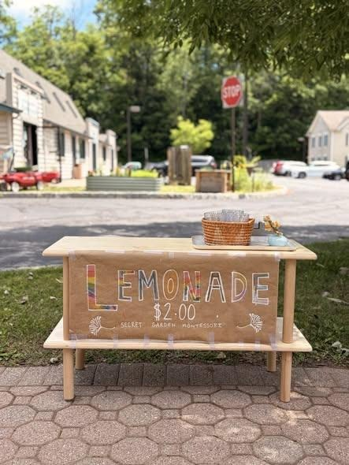

Frenchtown has the benefit of two vibrant pre-school programs on-site within the borough. One program is offered by the Frenchtown Elementary School: the Little Paws Preschool which offers a full-day program starting at age 3 that is fully integrated into the elementary school curriculum. The second is the private Secret Garden Montessori, located at the Frenchtown Barn Theater at 1110 Harrison St., which prides itself on offering a child-centered approach to learning.

Secret Garden’s story began in 2006 when a dedicated group of Delaware River Valley families partnered with Montessori educator Barbette Robillard to form a small, home-based learning cooperative. As local interest and enrollment grew, the program formalized its nonprofit structure around 2009–2010 and moved into its current home in the Barn Theater building owned by the DeSapio family. Today, the school has the capacity to serve up to 45 children—including four students who reside in Frenchtown Borough.

At the heart of Secret Garden is the educational philosophy of Dr. Maria Montessori (1870–1952), an Italian physician and educator who pioneered a method based on close observation of child development. Unlike traditional school environments, a Montessori classroom emphasizes an active role for students, who work at their own pace in mixed-age settings.  The school serves children in two distinct programs: a Toddler program for ages 18 months to 3 years, and a Primary program for ages 3 to 6. A typical day features a long, uninterrupted work cycle. During this time, children select developmentally appropriate activities, working independently or in small groups with guidance from staff who hold credentials from the Princeton Center for Teacher Education. Classrooms blend traditional academic subjects—such as language, math, art and cultural studies—with practical life skills that foster independence, concentration, and social responsibility.

Secret Garden’s mission is to cultivate compassionate, critical thinkers who are holistically prepared for the future. This commitment extends beyond the classroom walls through active community involvement. Students participate in gardening, service projects, and local initiatives that build meaningful connections with the surrounding environment.  As the school looks toward the future, it continues to explore long-term facility plans, which could include expanding within its current location or eventually pursuing a larger permanent home in the area. For families interested in joining the community, the school maintains waiting lists for both its Toddler and Primary programs, with tuition assistance and scholarship opportunities available for eligible families.

Whether they are tending to gardens, exploring math concepts with hands-on materials, or playing at the local field, Secret Garden students represent a thriving, thoughtful chapter of Frenchtown’s educational landscape.  For more information on Secret Garden or to sign your child up for programs, contact  [info@secretgardenmontessori.org](mailto:info@secretgardenmontessori.org).

