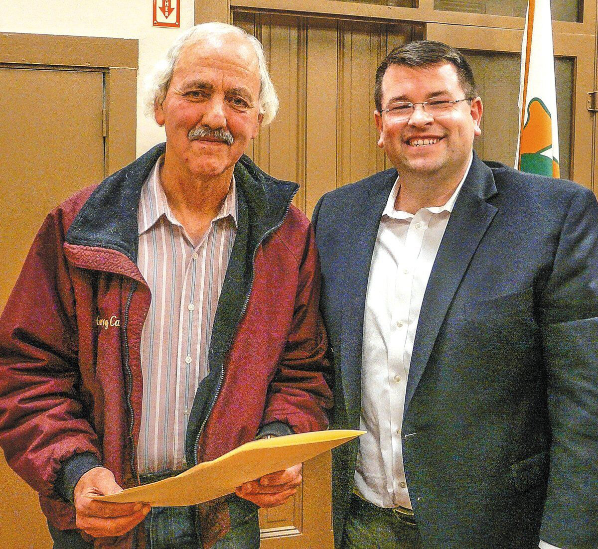

With its main entrance on Trenton Ave., the beautiful Frenchtown Cemetery is an integral part of local history and culture. It operates as a Mutual Cemetery Company under IRS regulations and is governed by the current Trustees of the Frenchtown Cemetery Association: Timothy Downing Brown, Charles Eichlin, Leslie Stintsman, Gordon Dragt, Susie Swider and Jerry Case. Case, who served as Superintendent for over 45 years, now holds the title of Superintendent Emeritus. The board also honors the memory of Dennis Carr, a devoted trustee of 24 years who passed away in February 2026; his wife, Patricia, carries on the long-standing Carr family tradition of placing seasonal and holiday flowers on gravesites.

The cemetery does not have a religious affiliation, and it accommodates a wide range of cultural, religious and traditional needs, offering traditional burial and cremation interments. As a small non-profit that generates revenue primarily through plot sales, interment services, and modest investment yields on its funds, all proceeds are reinvested into maintaining the property, with no private stock or dividend distributions. Consistent with state law, the cemetery maintains a permanent trust funded by deposits from a fixed percentage of every grave sale. The principal deposited into the trust can never be spent; instead, it is invested to generate income that, along with donations, is used to maintain cemetery grounds. The internal roads are owned by the Cemetery Association; and the borough has no responsibility for the upkeep or maintenance of cemetery property and roads. As a registered non-profit mutual cemetery association, the cemetery is exempt from local property taxes; an outhouse next to the toolshed and a handpump connected to a well provides sewer and water services.

Given its long history in Frenchtown and its important contributions to the borough, the French-town Cemetery welcomes visitors to view its grounds and explore its history while respecting the grave-sites of those who are buried there. Any individual interested in purchasing a plot or making a tax-deductible donation to the Cemetery can contact: Timothy Downing Brown at <a href="tel:908-752-0539">908-752-0539</a>; or Charles Eichlin at <a href="tel:908-996-2308">908-996-2308</a>; or email [frenchtowncemetery@gmail.com](mailto:frenchtowncemetery@gmail.com).

*Jerry Case, Superintendent Emeritus of the Frenchtown Cemetery, and Mayor Brad Myhre, 2018. Photo Courtesy of the Bucks County Herald*

### Frenchtown Cemetery History

Frenchtown Cemetery originated in 1810 as a private family graveyard for the Mallet-Prevost family. The first burial recorded on the grounds was that of Jeanne Patry Mallet-Prevost, wife of Paul Henri Mallet-Prevost. For nearly five decades, the site served as the family’s private resting place until 1857, when the Prevost family established the Frenchtown Cemetery Association and opened the cemetery to the public. Following its public establishment, the first recorded public burial was Isaac F. Tomson (1835-1857), whose headstone remains standing a few hundred feet past the entrance gate along the left side of the main drive. Shortly thereafter, Jacob Rounsavell (1817-1857) became the second public internee.

As Frenchtown grew, the cemetery expanded to accommodate the community. By 1880, the grounds contained more than 500 graves prompting the installation of a distinctive stone fence across the front perimeter. In 1897, local builder John L. Slack constructed the grounds’ only frame structure—a wooden tool house—for $261. In 1901, the main avenue through the grounds was macadamized to improve access for funeral processions and visitors.

Among the most prominent monuments are those in memory of Private Garret Roberson, who died at the Battle of Gaines Mills in 1862; Robert Rittenhouse, who was “lost at sea” in 1935 when the USS Havana ran aground on a reef in the Bahamas; and of Private William Finney Jr. and other victims of a spinal meningitis outbreak at Jefferson Barracks in Missouri in 1907. Today, the cemetery spans approximately 14.5 acres and serves as the final resting place for nearly 5,800 individuals. 

*—Excerpt courtesy of* Frenchtown *and* More Frenchtown *by Rick Epstein.*
