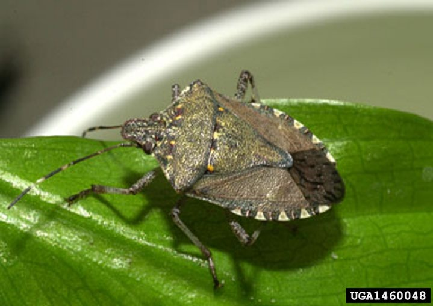

This time of year, many folks are vexed by large brown-colored stink bugs trying to get into their houses. This is a fairly new problem—caused by an invasive species, the Brown Marmorated Stink Bug (*Halyomorpha* *halys*). This Asian insect was accidentally introduced into the United States and first found in North America nearby in Allentown, PA, in 1996  (having likely been introduced on packing material from overseas).  Since then, this insect has spread throughout much of the United States and become a pest of various fruits, field crops and ornamental plants.

Adult Marmorated Stink Bugs are fairly easy to identify—they are just under an inch long and shaped like a shield. The adults enter houses in the fall simply looking for a protected space to spend the winter.  Because they feed exclusively on plants, they cannot harm people or pets. As a matter of fact, they scarcely feed during the winter months and do not reproduce—but they certainly can become a nuisance: walking around, being crushed underfoot, flying to lights. Like all stink bugs, they only emit a foul smell when disturbed or crushed. Because of the smell, it is best not to crush them. To move them, you can gently catch them for release outside or vacuum them up (although vacuuming them may cause a stink!).

It should be noted that our native stink bugs are, by and large, much better behaved and do not try to enter our houses in the winter. Hunterdon County is home to quite a few native species of (characteristically shield shaped) stink bugs: the Green, Brown, Juniper, Harlequin, Anchor, Twice Stabbed, Elf Shoe, Tuxedo, Spined Soldier and others. Most of these also feed by sucking plant sap through their piercing-sucking mouthparts, and a few of them, like the Spined Soldier Bugs, are predatory on other insects. But all of these native insects go about their lives in our gardens and woodlands without us ever noticing—it is only the introduced Marmorated Stink Bug that invades our houses in the fall. 

—*Randi Eckel*

*Photo Courtesy of David R Land, USDA APHIS PPQ, [www.bugwood.org](http://www.bugwood.org)*
